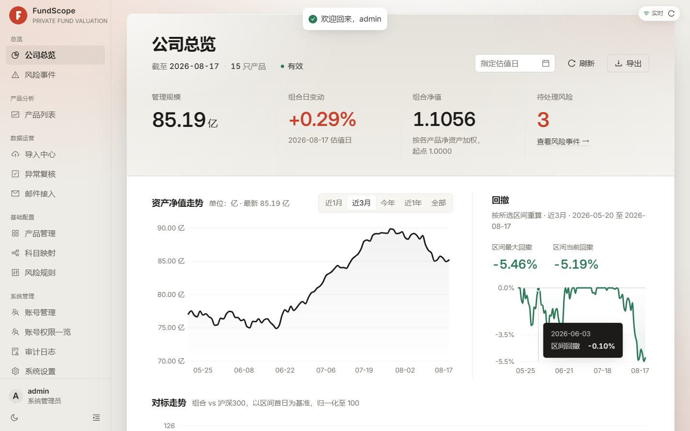
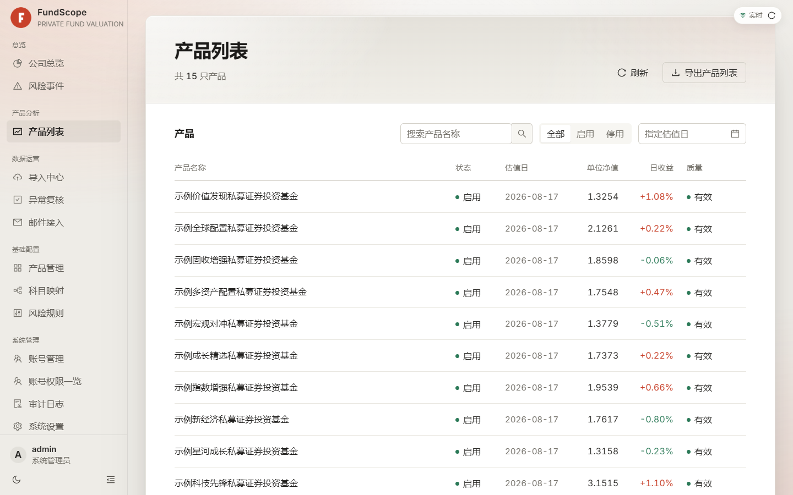
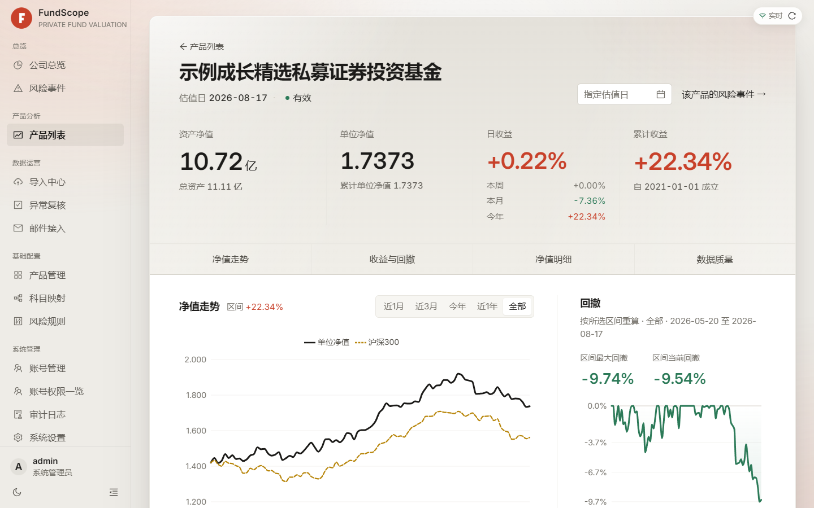
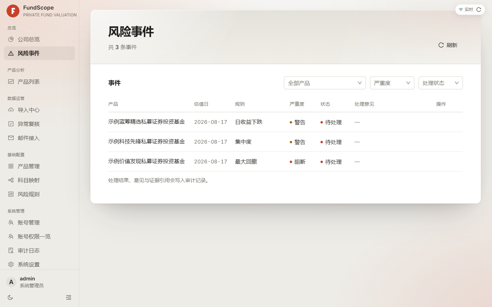
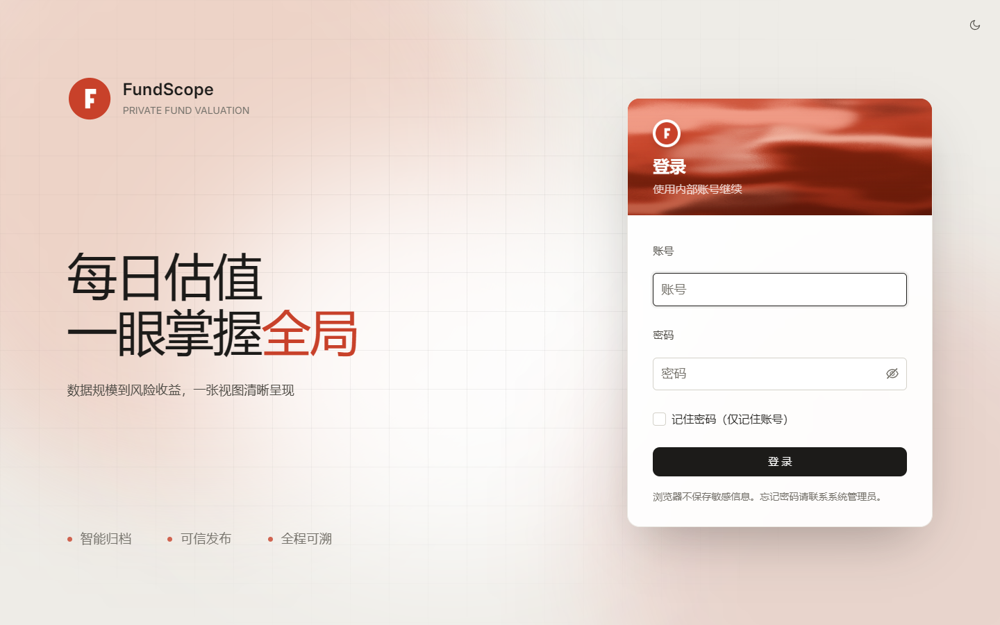

# FundScope · 基金估值运营看板

[](LICENSE)

面向私募基金内部运营与管理层的估值数据分析系统。接收日常估值 Excel，在服务端完成**安全归档 → 标准化 → 质量校验 → 自动发布 / 异常人工复核 → 后台分析 → 风险事件**的完整链路，再通过网页看板与 CSV 导出提供结果；同时提供复用同一前端、连接同一 API 的 Windows 桌面客户端（Tauri 2）。

> 项目内的产品名、机构名与域名均为**虚构示例**，仅用于演示与测试。配合内置演示数据（`app.dev_seed`），你可以零外部依赖地跑起整套界面进行体验。

## 界面预览

以下截图来自本地开发栈 + 内置演示数据（15 只虚构产品、90 个估值日）。

| 公司总览 | 产品列表 |
| --- | --- |
|  |  |

| 产品详情（净值与回撤） | 风险事件 |
| --- | --- |
|  |  |

| 登录页 |
| --- |
|  |

## 项目价值

私募基金估值文件通常来自邮件或业务员手工上传，格式和文件名可能不稳定，且需要保留原始文件以便复核。本项目把这条链路收敛为可审计的数据流程：

- 同一套解析、校验和发布状态贯穿手工上传、邮件附件和历史迁移，减少多套逻辑产生的口径差异。
- 原始文件用 SHA-256 去重并以服务端随机对象名保存，下载受权限、批次关联和路径安全控制。
- 估值版本不可就地修改；修订通过新版本、复核、发布和替代完成，历史结果有迹可循。
- 发布后的分析通过数据库任务和独立 worker 执行，看板优先读取持久化结果，并明确返回分析是否就绪或过期。
- 关键写操作、下载、导出、备份和清理均写入脱敏审计记录。
- 面向十几个产品、每天十几至几十个文件和 2C4G 服务器设计，使用 PostgreSQL 任务表，不引入不必要的缓存集群或消息队列。

## 重要边界

业务数据唯一来自估值 Excel。邮件、上传和历史迁移只是接入方式，不是额外的数据源。产品策略、管理人、别名、份额类别、科目映射、风险规则和账号是人工维护配置。

当前可以可靠提供：净资产、资产负债、单位净值、累计单位净值、累计派现、日/周/月/季/年初/累计收益、份额快照、科目和持仓、市值权重、资产类别聚合、集中度、产品回撤、公司加权指数、质量校验和基于这些字段的风险规则。

当前不承诺：外部基准、Alpha、Beta、跟踪误差、信息比率、行业/主题/风格穿透、VaR、压力测试、精确流动性天数、交易归因、申赎现金流、合同或监管限额判断。这些能力需要新的数据源和经过批准的业务口径，不能从现有 Excel 的偶然字段推断。

## 功能概览

### 数据接入和治理

- 手工批次上传 `.xls` / `.xlsx` 估值表。
- IMAP 只读同步邮件附件，支持连接测试、立即同步、同步记录、管理员更新邮箱账号和授权码、暂停/恢复自动同步。
- 文件头、大小、扩展名、临时目录、路径、工作簿规模和哈希检查。
- 解析器按表头和内容识别，不依赖固定行号；未知产品/日期和同日内容冲突进入人工复核。
- 任务失败可按明确技术失败条件重试，不提供无限制重试或手工篡改版本。

### 估值版本和分析

- 导入后形成估值版本，执行资产负债、份额净资产、日收益和持仓市值等校验。
- 无阻断级且无警告的导入版本自动发布；阻断级问题进入待复核；只有警告的版本保留为可发布并需要明确确认。
- 发布、驳回、撤回、恢复和同日替代均受状态机、数据库约束和审计保护。
- 发布后创建分析运行任务，计算产品日指标、公司指标和风险事件并落库。

### 查询和导出

- 公司总览：净资产合计、产品覆盖、公司日收益、公司指数、开放风险数量和质量状态。
- 产品列表和详情：净值序列、收益、回撤/峰值指标、持仓分页和数据质量。
- 风险事件查询和处理。
- 总览、产品列表、产品摘要、净值序列、资产配置、持仓、份额和导入报告 CSV 导出。
- 所有可见数据只来自活动产品的已发布版本；未发布和待复核数据不进入看板。

### 配置和运维

- 产品、别名、份额类别、科目映射和风险规则维护。
- 账号角色（管理员 / 业务员 / 普通看板 / 老板）与产品级可见范围控制；可维护老板端「账号权限一览」。
- 审计查询、系统设置、worker 心跳、任务队列、备份状态和磁盘摘要。
- 原始文件清理必须先预演，再使用固定确认语句执行；标准化数据和审计日志不随原始文件清理。

## 系统架构

```text
浏览器 / Windows 桌面客户端（Tauri，联网读取并校验当前产品权限）
          |
          v
Caddy（静态文件、同源 HTTPS、/api 反向代理）
          |
          v
FastAPI API（认证、接入、查询、配置、导出、维护）
          |                         \
          v                          v
PostgreSQL（业务数据和任务表）   原始文件卷
          ^                          ^
          |                          |
独立 worker（解析、校验、分析）  受控下载/清理
```

生产 Docker Compose 包含四个服务。桌面客户端通过 Tauri 外壳复用同一份前端，连接同一个生产 API。业务读取和管理操作均由服务器按当前账号的角色与产品范围校验；业务数据需要联网读取，断网时不回退到旧的本地数据，不引入额外的本地数据库。

| 服务 | 职责 |
| --- | --- |
| `caddy` | 提供前端静态文件、SPA 路由回退、HTTPS 和 `/api`/`/health` 反向代理 |
| `api` | 认证、上传、查询、复核发布、配置、导出、邮件操作和维护 API；不在请求内解析 Excel |
| `worker` | 从数据库任务表领取导入/分析任务，执行解析、校验、指标和风险事件落库 |
| `db` | PostgreSQL 16，保存账号、配置、原始文件元数据、估值、分析、风险、任务和审计 |

不使用 Redis、Celery、Kubernetes 或独立 Node.js 生产前端服务。Caddy 镜像在构建时打包前端静态资源。

## 数据处理流程

```text
上传 / 邮件附件 / 历史迁移
        -> 临时文件和安全检查
        -> source_file（原始文件元数据）与 import_batch（导入批次）
        -> worker 领取任务
        -> Excel 解析、产品/日期识别、字段标准化
        -> valuation_version（估值版本）和明细
        -> 校验：干净版本自动发布；warning 版本 publishable；critical 版本 pending_review
        -> 每产品合并分析任务；异常版本按需人工复核与发布
        -> analysis_run（分析运行）任务
        -> 产品指标、公司指标、风险事件落库
        -> 看板只读取已发布数据和可用分析结果
```

金额、净值、收益和权重在数据库中使用十进制定点数；JSON 中通常以字符串返回，避免 JavaScript 浮点误差。日期使用 `YYYY-MM-DD`，时间使用 ISO 8601。

## 角色

| 角色 | 能力 |
| --- | --- |
| `admin`（管理员） | 全部看板、导入、复核发布、目录/规则、账号、系统设置、审计、邮箱账号/授权码和原始文件清理 |
| `operator`（业务员） | 全部看板、导入、复核发布、目录/风险规则、邮件运营和审计查询 |
| `viewer`（普通看板） | 全部已发布看板和风险读取；可配置风险规则（事件处理仍限管理员/业务员），不得执行其他写入或下载原始文件 |
| `boss`（老板） | 只读看板与「账号权限一览」，用于了解运行状况与可见范围 |

以上角色能力以「全部产品」账号为基准。管理员始终可访问全部产品；业务员和普通看板用户默认全部产品，也可由管理员在账号管理中选择指定产品，保存后对现有登录的下一次请求生效。指定产品模式下，列表、详情、总览统计、风险和导出只覆盖授权产品；业务员的导入、复核及产品维护同样受限。邮件、全局科目映射、全局风险规则、新建产品等跨产品功能仅对拥有全部产品权限的相应角色开放。详见 [产品权限说明](docs/产品权限说明.md)。

前端菜单只改善体验，后端鉴权才是安全边界。会话使用 HttpOnly Cookie；当前网页登录不使用 Bearer 头。

## 仓库结构

```text
backend/app/api/              HTTP 路由和响应组装
backend/app/auth/             账号、密码、会话和权限
backend/app/db/               SQLAlchemy 模型、枚举和会话
backend/app/parser/           Excel 读取、解析和标准化
backend/app/imports/          文件、批次、任务领取和处理
backend/app/publishing/       复核、发布、替代、撤回和恢复
backend/app/analytics/        产品/公司指标和持久化分析
backend/app/validation/       校验规则
backend/app/risk/             风险规则和事件
backend/app/mail/             IMAP 同步和凭据文件
backend/app/system/           健康、备份、清理和系统设置
backend/app/migration/        历史目录迁移
frontend/src/                 正式 React 页面和 API 适配器
frontend/src-tauri/           Windows 桌面客户端（Tauri 2）
tools/valuation_inventory/    只读历史文件盘点工具
deploy/                        Compose、Caddy 和配置模板
docs/                          权威文档
```

## 快速开始（本地开发）

环境要求：Python 3.12+、Node.js 20.19+；Docker 仅在生产部署时使用。

### 后端

```powershell
python -m venv .venv
\.venv\Scripts\python.exe -m pip install -e "backend[test]"
\.venv\Scripts\python.exe -m alembic -c backend/alembic.ini upgrade head
\.venv\Scripts\python.exe -m uvicorn app.main:app --app-dir backend --reload
```

开发默认使用本地 SQLite（`data/dev.db`）。

### 写入演示数据

首次做界面联调时，写入一套确定性的虚构演示数据（15 只产品、90 个估值日）：

```powershell
Set-Location backend
..\.venv\Scripts\python.exe -m app.dev_seed
```

演示数据的产品名均为虚构示例（如「示例价值发现私募证券投资基金」），产品代码带 `DEMO-` 前缀，重复执行自动跳过；可通过 `--latest-date YYYY-MM-DD` 指定最新估值日。

### 前端

另开一个终端：

```powershell
Set-Location frontend
npm ci
npm run dev
```

访问 `http://127.0.0.1:5173`。Vite 会把 `/api` 与 `/health` 代理到 `http://127.0.0.1:8000`。首次访问进入初始化页，创建管理员账号后即可登录体验。

## 质量检查

```powershell
Set-Location <repo root>
\.venv\Scripts\python.exe -m ruff check backend tools/valuation_inventory
\.venv\Scripts\python.exe -m ruff format --check backend tools/valuation_inventory
\.venv\Scripts\python.exe -m ty check backend/app
\.venv\Scripts\python.exe -m pytest backend/tests -q
\.venv\Scripts\python.exe -m pytest tools/valuation_inventory/tests -q

Set-Location frontend
npm run typecheck
npm test -- --run
npm run build
```

GitHub Actions 会在推送和合并请求中执行同等门禁。测试不依赖生产数据库、真实邮箱或历史源目录。可选：安装 `.pre-commit-config.yaml` 钩子把检查挂到 `git commit` 上。

`ruff` 与 `ty` 在 `backend/pyproject.toml` 里锁定精确版本，钩子修订号保持一致；升级工具时两处要一起改，否则本地钩子与 CI 的判定会出现分歧。

## API

登录、看板、导入、复核、目录、风险、邮件、维护和导出接口的完整说明见 [docs/API接口说明.md](docs/API接口说明.md)。运行实例还提供 `/health/live`（存活检查）、`/docs`（交互式接口文档）和 `/openapi.json`（机器可读接口描述）。

普通成功响应通常使用 `data`，需要分页时附带 `meta`；文件导出返回 CSV 流。错误状态主要为 `400`、`401`、`403`、`404`、`409`、`413` 和 `422`。

## 桌面客户端

`frontend/src-tauri/` 是基于 Tauri 2 的 Windows 桌面外壳，打包同一份 React 前端，连接同一个 API。客户端对可缓存的 GET 读取做本机缓存，登录、写操作、导出和管理流程仍直接请求服务器；自 0.2.0 起支持自动更新。构建与发布约定见 [docs/runbook.md](docs/runbook.md) 的桌面客户端部分。

## 生产部署与安全

- 生产部署基于 Docker Compose（`deploy/compose.prod.yml`），Caddy 自动申请 HTTPS 证书；完整初始化、备份、恢复、升级和回滚见 [docs/runbook.md](docs/runbook.md)。示例域名 `fundscope.example.com` 需替换为你自己的域名。
- PostgreSQL 使用 `pg_dump` 生成 custom format 备份并验证可读；原始文件默认保留 365 天，清理必须先预演并输入固定确认语句。建议将数据库归档与原始文件打包后推送至独立的异地备份存储，并配置定时校验与告警。
- 密码使用 Argon2id 哈希；会话数据库只保存高熵令牌的 SHA-256 摘要；授权码只保存在受控文件或环境变量中。
- 上传、下载、导出、账号、发布、备份和清理均记录审计。

## 文档与贡献

开发前先阅读 [docs/README.md](docs/README.md)。长期文档包括产品范围、UX 设计指南、系统架构、API、历史迁移指南和生产运行手册。

欢迎通过 Issues 报告问题、通过 Pull Request 贡献代码。请先阅读 [CONTRIBUTING.md](CONTRIBUTING.md)，并按上面的质量门禁在本地验证；安全漏洞请遵循 [SECURITY.md](SECURITY.md) 私下报告。本项目使用 MIT 许可，见 [LICENSE](LICENSE)。

> 注意：项目内所有产品名、机构名、域名与示例凭据均为虚构占位。提交代码时不要引入真实基金、企业、域名或凭据。